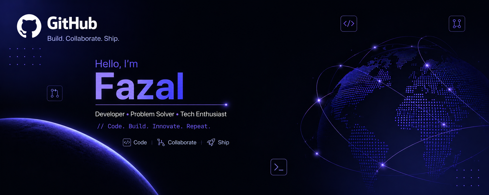

  

## 🔭 Currently Working On
- 🧠 **RAG-based assistants** with FastAPI + Ollama + Chroma for enterprise-grade search & chatbot workflows.  
- 🤖 **Enterprise chatbots** (commissions, promotions, store ops, time correction) with multi-model orchestration:  
  - `llama3.1:8b` → Commissions  
  - `mixtral:8x7b` → Contact lookup  
  - `deepseek-r1:1.5b` → Document Q&A  
- ⚡ **Hybrid retrieval pipelines** (dense + sparse search, reranking, fallback handling).  
- 🌐 **Full-stack deployments**: Django + React + Docker + Nginx + GitHub Actions CI/CD (AWS).  
- 🔬 **Fine-tuning open-source LLMs** (Falcon-7B, LLaMA, Mistral) with Excel/JSON data.  
- 📹 **Streaming pipelines**: RTSP → WebSocket → MJPEG with Nginx reverse proxy + SSL.  

---

## 📚 Currently Learning
- Hugging Face Transformers & **LangChain / LlamaIndex** advanced workflows.  
- **Redis Stack RAG design** with observability (Grafana monitoring).  
- Building **Transformer architecture from scratch in NumPy** (encoder-decoder seq2seq).  
- Optimizing **scalable chatbot infrastructure** for 3000+ users.  

---

## 🎯 Goals
- 🚀 Deploy production-ready **company-specific GPT** with RBAC, SQL Server integration & Docker.  
- 📊 Open-source starter templates for **LLM-powered assistants** (LangChain, LangGraph, LangSmith).  
- 🔧 Improve **reliability & monitoring** of real-time AI & streaming systems.  

---

## 🛠️ Tech Stack
**Languages**: Python | JavaScript | SQL  
**Frameworks**: FastAPI | Django | React | Streamlit  
**AI/ML**: Hugging Face | LangChain | LlamaIndex | Ollama  
**Infra/DevOps**: Docker | Nginx | AWS | GitHub Actions | Grafana  
**Databases**: MS SQL Server | Redis | Chroma | Postgres  

---

## 📫 Connect
- 💼 [LinkedIn](#)  
- 🌐 [Portfolio/Website](#)  
- 📧 Email: *khanfa719@gmail.com*  

---

⭐️ *Always building, always learning — pushing the boundaries of AI and full-stack systems.*
